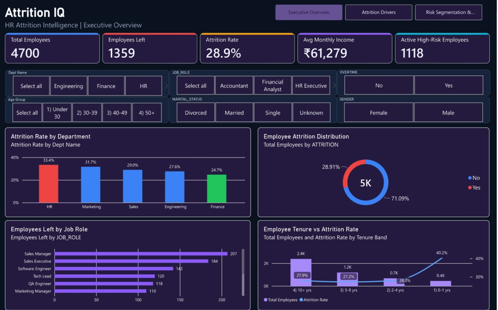
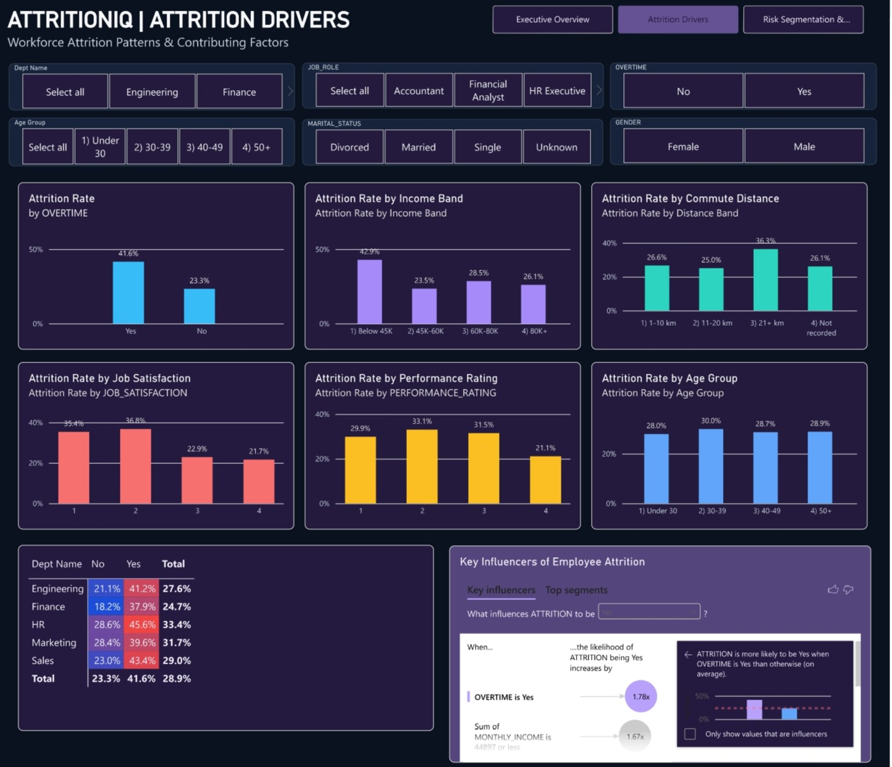
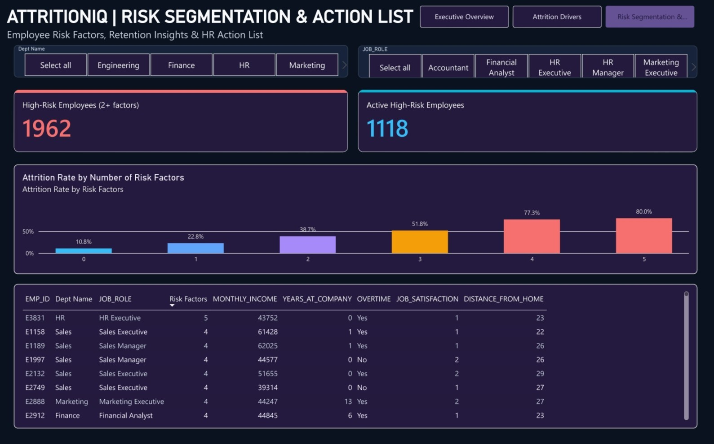

# HR Attrition Intelligence | HR Attrition IQ

A Streamlit workforce analytics dashboard for exploring employee attrition patterns, potential contributing factors, and employee risk segments. The project uses Python, Pandas, Plotly, Snowflake connectivity, and a saved Random Forest model artifact.

🌐 **Live Dashboard:** [Open HR Attrition IQ](https://hr-attrition-iq-fz7cy8ubamq9xq3jff4qib.streamlit.app/)  
💻 **GitHub Repository:** [HR-Attrition-IQ](https://github.com/yashchaudhari372-lab/HR-Attrition-IQ)

---

## 📌 Project Overview

Employee attrition can lead to recruitment costs, loss of organizational knowledge, and disruption to teams. HR Attrition IQ provides an interactive dashboard to explore workforce metrics and understand how attrition varies across departments, job roles, overtime, income, job satisfaction, performance ratings, age groups, tenure, and commute distance.

The project includes three dashboard views: **Executive Overview**, **Attrition Drivers**, and **Risk Segmentation & Action List**. These views help users explore patterns and identify areas for further HR investigation.

> This dashboard is a decision-support and analytics tool. Risk indicators are not guarantees that an employee will leave and should not be used as the sole basis for employment decisions.

## 🎯 Objectives

- Summarize employee headcount, exits, attrition rate, average monthly income, and high-risk employee counts.
- Compare attrition patterns across departments and job roles.
- Explore attrition patterns by overtime, income band, commute distance, satisfaction, performance rating, age group, and tenure.
- Provide filters to explore relevant workforce segments.
- Present employee risk-factor information for further review.
- Connect to Snowflake when the required credentials and database objects are configured.

## ✨ Dashboard Features

### 1. Executive Overview
- Total employees, employees left, attrition rate, average monthly income, and active high-risk employee count.
- Attrition rate by department.
- Employee attrition distribution.
- Employees left by job role.
- Employee tenure versus attrition rate.
- Interactive workforce filters.

### 2. Attrition Drivers
- Attrition rate by overtime status.
- Attrition rate by monthly income band.
- Attrition rate by commute-distance band.
- Attrition rate by job satisfaction.
- Attrition rate by performance rating.
- Attrition rate by age group.
- Department-level attrition distribution.
- Filters for available employee attributes, such as department, job role, age group, marital status, gender, and overtime.

### 3. Risk Segmentation & Action List
- High-risk employee and active high-risk employee summaries.
- Attrition rate by number of risk factors.
- Department and job-role filters.
- Employee-level fields such as employee ID, department, job role, risk-factor count, monthly income, years at company, overtime, job satisfaction, and distance from home.

Risk-factor definitions depend on the logic implemented in the application. Treat them as prompts for supportive review, not as proof about an individual employee.

## 🖥️ Dashboard Screenshots

### Executive Overview
A high-level view of workforce KPIs, department-wise attrition, exits by job role, and tenure patterns.



### Attrition Drivers
An interactive view of attrition patterns across overtime, income, commute distance, job satisfaction, performance rating, age group, and department.



### Risk Segmentation & Action List
A view of employee risk-factor counts, attrition rates across risk segments, and employee-level fields for further review.



## 📊 Example Patterns Shown in the Screenshots

The supplied dashboard screenshots illustrate differences in displayed attrition rates by department, overtime status, income band, commute distance, job satisfaction, age group, and number of risk factors. For example, the screenshots show a higher displayed attrition rate for the overtime “Yes” group than the “No” group.

These are descriptive patterns from the displayed dashboard data; they do not prove causation. Values may change when filters or source data change. Validate any figures against the underlying data before using them in a formal report.

## 🧰 Technology Stack

| Technology | Purpose |
|---|---|
| Python | Application logic and data processing |
| Streamlit | Interactive web dashboard |
| Pandas | Data manipulation |
| Plotly | Interactive charts |
| Snowflake | Cloud data access when configured |
| Scikit-learn / Random Forest | Saved model artifact used by the project |
| Joblib or pickle-based loading | Loading saved model artifacts, depending on the implementation |

## 🗂️ Project Structure

```text
hr_attrition_intelligence/
├── .venv/                         # Local virtual environment; do not commit
├── models/
│   └── attrition_model.pkl         # Saved model artifact
├── outputs/
│   ├── attrition_by_department.png
│   ├── attrition_by_overtime.png
│   └── salary_vs_attrition.png
├── src/
│   ├── connect_snowflake.py
│   ├── eda.py
│   └── train_model.py
├── assets/
│   └── dashboard/
│       ├── executive-overview.jpg
│       ├── attrition-drivers.jpg
│       └── risk-segmentation-action-list.jpg
├── .env                            # Local secrets; do not commit
├── .gitignore
├── app.py
├── main.py
├── README.md
└── requirements.txt
```

This tree reflects the structure shown for the project. Keep any additional files already present in your local repository.

## ⚙️ Local Installation

### Prerequisites
- Python installed on your machine.
- Git.
- Snowflake access and the required database/table permissions if you want to use database-backed features.

### 1. Clone the repository

```bash
git clone https://github.com/yashchaudhari372-lab/HR-Attrition-IQ.git
cd HR-Attrition-IQ
```

### 2. Create and activate a virtual environment (optional if you already have one)

**Windows PowerShell**
```powershell
python -m venv .venv
.\.venv\Scripts\Activate.ps1
```

**macOS / Linux**
```bash
python -m venv .venv
source .venv/bin/activate
```

### 3. Install dependencies

```bash
python -m pip install --upgrade pip
pip install -r requirements.txt
```

### 4. Configure environment variables

Your project already contains a local `.env` file. Keep it private and confirm the exact variable names expected by `src/connect_snowflake.py` or your app before configuring a new environment. Do not paste real credentials into this README.

If using Streamlit Community Cloud, add the required values under the app's secrets settings using the names expected by your code.

### 5. Run the app

Try the command used by your project:

```bash
streamlit run app.py
```

If your intended entry point is `main.py`, use `streamlit run main.py` instead. Use the entry point that matches your current app setup.

## 🚀 Live Deployment

**Live Dashboard:** [HR Attrition IQ](https://hr-attrition-iq-fz7cy8ubamq9xq3jff4qib.streamlit.app/)

For deployment, make sure required packages, model artifacts, and secret settings are configured in the hosting environment. Test the deployed app after changes to confirm database access, filters, charts, and model loading work correctly.

## 🔐 Security and Responsible Use

- Never commit `.env`, passwords, access tokens, private keys, or confidential employee data.
- Keep `.venv/` out of Git; install dependencies from `requirements.txt` instead.
- Use least-privilege database permissions.
- Restrict access to employee-level tables and exported files.
- Attrition patterns are associations, not proof of cause.
- Validate model quality and potential bias before operational use.
- Use risk indicators to support fair, human-led review—not as the sole basis for employment decisions.

## 🔬 Suggested Validation Checklist

- [ ] The dashboard starts locally and in the deployed environment.
- [ ] Snowflake connection and query permissions are configured correctly.
- [ ] All dashboard pages and filters work as expected.
- [ ] Charts handle missing values and empty filtered results.
- [ ] The saved model loads from the path expected by the application.
- [ ] Prediction inputs match the model's expected features and preprocessing.
- [ ] Reported model metrics are backed by a held-out evaluation.
- [ ] No credentials or sensitive employee records are exposed.

## 🔮 Future Enhancements

- Add a model evaluation report with precision, recall, F1-score, ROC-AUC, and a confusion matrix.
- Add model calibration and fairness checks across relevant employee groups.
- Add historical attrition trends and data-quality monitoring.
- Add clear explanations for model outputs where technically supported.
- Add automated tests for filters, database access, predictions, and exports.

## 🔗 Project Links

- **Live App:** [HR Attrition IQ](https://hr-attrition-iq-fz7cy8ubamq9xq3jff4qib.streamlit.app/)
- **GitHub:** [HR-Attrition-IQ Repository](https://github.com/yashchaudhari372-lab/HR-Attrition-IQ)

If you find the project useful, consider starring the repository and sharing feedback.
